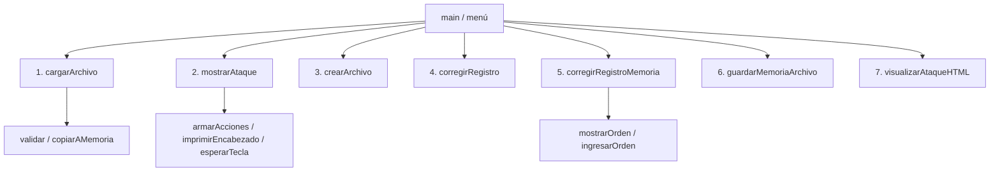

## Trabajo práctico grupal — Sistema de guía de apoyo para drones

**Cátedra:** Algoritmos y Estructura de Datos  
**Docente:** Ing. Méndez  
**Ciclo lectivo:** 2026  
**Comisión:** K1005
**Grupo:** [COMPLETAR]  
**Fecha de entrega:** 04/11/2026 

### Integrantes

| Apellido y nombre | Legajo | Correo electrónico | Tareas realizadas |
|---|---|---|---|
| [INTEGRANTE 1] | [LEGAJO] | [CORREO] | Puntos 1 , 2 y 7 |
| [INTEGRANTE 2] | [LEGAJO] | [CORREO] | Puntos 3, 4 y 7 |
| Quintas Azul | 220.977-9 | aquintas@frba.utn.edu.ar  | Puntos 5, 6 y 7|


---

## 1. Objetivo y solución

Se desarrolló un programa en **C++** para administrar una secuencia de órdenes de un dron. Las órdenes se representan mediante una matriz de **200 × 200** posiciones y se pueden leer, modificar y guardar en **archivos binarios**

Se utilizan dos estructuras: `Orden`, para guardar acciones y siguiente posición en memoria; y `OrdenArchivo`, que además contiene las coordenadas `x` e `y` de cada registro del archivo. La matriz `memoria` contiene las órdenes y `ocupada` identifica las posiciones con datos

| Punto | Función | Operación |

| 1 | `cargarArchivo()` | Lee y valida un archivo binario; carga las órdenes en memoria. |
| 2 | `mostrarAtaque()` | Muestra el recorrido desde el despegue, con pausas cada 20 líneas. |
| 3 | `crearArchivo()` | Crea un archivo binario a partir de órdenes ingresadas por teclado. |
| 4 | `corregirRegistro()` | Busca y modifica un registro dentro de un archivo. |
| 5 | `corregirRegistroMemoria()` | Busca y modifica una orden en la matriz. |
| 6 | `guardarMemoriaArchivo()` | Guarda las posiciones ocupadas en un nuevo archivo binario. |
| 7 | `visualizarAtaqueHTML()` | Genera una tabla HTML de 200 × 200 con las órdenes cargadas. |


## 2. Hipótesis y controles

- Las coordenadas válidas van de **0 a 199** y cada posición admite una sola orden.
- Debe existir **un único despegue** sin ataques asociados y una única finalización, mediante aterrizaje o ataque kamikaze.
- Las posiciones consecutivas deben ser aledañas; el recorrido no debe salir de la matriz, repetir celdas ni atravesar posiciones vacías.
- Para las opciones 5, 6 y 7 se necesita haber cargado previamente un ataque.
- **Limitación:** al corregir una orden (puntos 4 o 5), no se vuelve a validar automáticamente toda la ruta. Un archivo modificado puede verificarse al volver a cargarlo con la opción 1.


## 3. Diagrama de subprogramas




## 4. Casos de prueba

| Prueba | Resultado observado |
| Cargar un archivo válido de dos órdenes y mostrar el recorrido | Se cargan dos órdenes: despegue en `(0,0)` y aterrizaje en `(0,1)` |
| Cargar un archivo con un despegue que también ataca | El programa informa el error y rechaza la carga |
| Generar la visualización HTML de un ataque cargado | Se crea una tabla con 200 filas y 40.000 celdas |

**Caso 1 — Carga y visualización de una ruta válida**


**Caso 2 — Rechazo de un archivo con despegue y ataque simultáneos**


**Caso 3 — Creación del archivo HTML**


## 5. Compilación y ejecución

Compilar únicamente el archivo que reúne los siete puntos y contiene el `main`:

```bash
g++ -std=c++11 TP_AYED_Integrado_Puntos_1_al_7.cpp -o tp_ayed
```

Ejecutar el programa y seleccionar las operaciones desde el menú. No compilar simultáneamente otros archivos con un `main` propio


## 6. Conclusión

Se integraron las siete operaciones del sistema utilizando estructuras, matrices, funciones, recorridos y archivos binarios. La salida HTML permite visualizar gráficamente las órdenes cargadas
